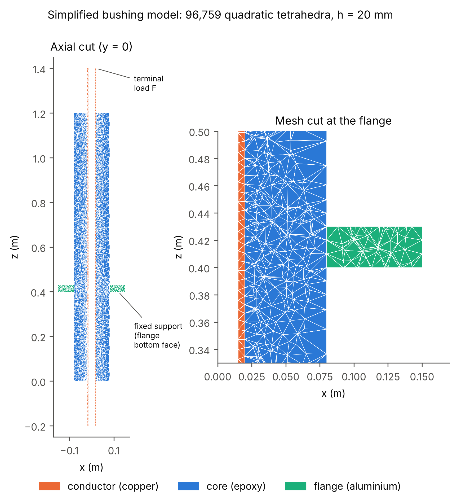

<!-- Generated by src/make_tables.py from docs/templates/README.md and results/results.json. -->
# Transformer Bushing FEA: Static, Modal and Thermal-Structural

A self-directed, simplified finite element study of a dry-type (resin-impregnated) transformer bushing, built only with open-source Python tools (Gmsh, FEniCSx/dolfinx, SLEPc, PyVista, Matplotlib). The model has three bonded bodies (copper conductor tube, epoxy core, aluminium flange) and covers a static terminal (cantilever) load, self-weight, a static-equivalent horizontal acceleration, modal analysis, steady-state Joule heating and the resulting thermal stress. Every FEA result is checked against a hand calculation. The load cases are *based on* the type of checks in IEC 60137 and IEEE 693, but the study does **not** claim compliance with these standards, qualification or a rated design. All material values are typical literature values, assumed.



## Key results (mesh h = 20 mm, 96,759 quadratic tetrahedra, 440,025 displacement DOFs)

| Quantity | Value |
|---|---:|
| S1 top deflection under F = 1,000 N | 1.185 mm |
| First natural frequency (bending, two near-equal directions) | 82.66 Hz and 82.68 Hz |
| Hot spot at I = 1,250 A, ambient 40 C | 86.1 C |
| Thermal von Mises stress, max in conductor / core / flange (fixed flange face) | 152.5 / 78.3 / 153.4 MPa |

## Verification against hand calculations

| Check | Analytical | FEA | Difference |
|---|---:|---:|---:|
| S1 top deflection, uniform composite cantilever | 0.845 mm | 1.185 mm | +40.3 % |
| S1 top deflection, two-segment cantilever | 1.103 mm | 1.185 mm | +7.4 % |
| f1, uniform composite cantilever | 56.39 Hz | 82.66 Hz | +46.6 % |
| f1, two-segment beam (1D beam elements) | 81.14 Hz | 82.66 Hz | +1.9 % |
| Conductor surface temperature rise above ambient at core mid-height, 1D radial | 27.70 K | 31.77 K | +14.7 % |
| Core surface temperature rise above ambient at core mid-height, 1D radial | 9.73 K | 11.15 K | +14.6 % |
| Temperature rise across epoxy at mid-height, 1D radial | 17.98 K | 20.62 K | +14.7 % |
| Temperature rise across epoxy at mid-height, 1D radial with FEA local heat flow | 20.60 K | 20.62 K | +0.1 % |
| Conductor top axial displacement, free copper expansion | 0.955 mm | 1.239 mm | +29.6 % |
| Conductor top axial displacement, bonded composite expansion (EA-weighted) plus free copper overhang | 1.208 mm | 1.239 mm | +2.5 % |

The two-segment beam and 1D conduction checks are the meaningful ones; the uniform-beam and free-copper rows are kept to show why the simpler formulas do not fit this geometry. See `report/report.pdf` for the explanations.

## How to run

```bash
conda env create -f environment.yml      # or: micromamba create -f environment.yml
conda activate bushing-fea
python src/run_all.py                    # all stages (12 minutes on the test machine)
python src/run_all.py --skip-convergence # keeps the stored convergence results, much faster
cd report && pdflatex report.tex && pdflatex report.tex
```

`run_all.py` regenerates `results/results.json`, every figure in `figures/`, the tables in `report/generated/` and the numbers in this README, `docs/EXPLAINER.md` and `docs/CV_ENTRY.md` (from `docs/templates/`). All parameters are in `config.yaml`. Tested with dolfinx 0.11.0, Gmsh 4.15.2, PETSc 3.25.6. The fine mesh of the convergence study needs a lot of memory; reduce `convergence_h` in `config.yaml` on a smaller machine.

## Repository layout

```
config.yaml      all geometry, material, load and mesh parameters (SI units)
src/             geometry.py, static.py, modal.py, thermal.py, thermo_mech.py, hand_calcs.py,
                 convergence.py, make_figures.py, make_tables.py, run_all.py
results/         results.json and field files (.vtu, open in ParaView)
figures/         PNG figures, 300 dpi
report/          report.tex (simulation report) and generated tables
docs/            EXPLAINER.md (plain-language walkthrough), CV_ENTRY.md
```

## Limitations

- Simplified geometry: no silicone sheds or housing, no condenser foils, no oil-side details, no draw lead in the bore.
- Perfect bonding between bodies, linear elastic isotropic materials, properties at a single temperature.
- The flange bottom face is fully fixed. This idealised mount over-predicts thermal stress near the flange; a sliding-support sensitivity case is included to show how much.
- Thermal stress assumes a stress-free state at 20 C. A real resin-impregnated core is cured at elevated temperature and has residual stress, so the thermal stress values are indicative only.
- Static-equivalent acceleration only; no response spectrum or time-history seismic analysis to IEEE 693.
- Resistivity at 20 C (no temperature dependence), no short-circuit electromagnetic forces, no dielectric losses.
